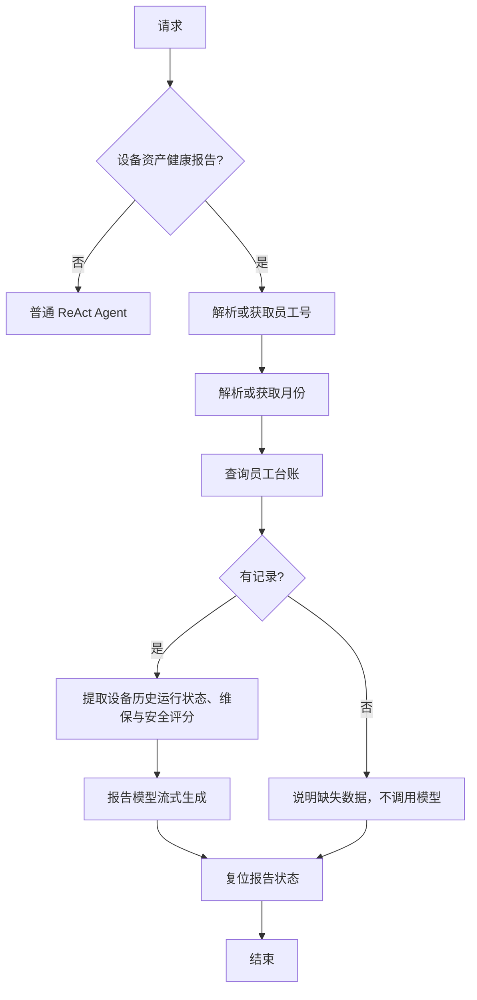

# 设备健康报告工作流

明确的设备资产健康报告请求由 `ReactAgent` 路由至 `ReportWorkflow`。普通故障排查、指标查询和知识问答继续使用原有 ReAct Agent，SSE 接口仍按模型输出逐块返回。



例如「生成 EMP1001 在 2025-06 的设备健康报告」会使用给定员工号和月份查询台账。月份也接受 `2025年6月`、`2025/06`、`2025.6`、`2025-6`，统一转换为 `2025-06`；「上个月」按当前月份换算。明确要求「刚才那位员工」或「再生成这份设备报告」时，会从之前的用户消息沿用员工号和月份，当前消息中的明确值优先。「生成我的本月设备健康报告」在当前未接入登录系统时，通过原有 `get_employee_id` 工具选取**演示员工号**；系统会在报告开头直接标明演示性质和身份未核验。未给出月份时使用当前月份。台账目前只包含截至 2026-08 的演示记录；若请求月份没有记录，系统会说明无法生成有依据的报告，不会用其他月份冒充当前月份。

工作流中的「设备状态」来自指定月份的台账，属于历史记录。MCP 监控的是服务所在主机或容器，不代表员工电脑，因而没有混入个人设备报告。报告提示词要求只根据查询到的配置、运行状态、维保和安全评分判断风险，不能补造数值或趋势。

生成节点会把员工号及这些台账字段发送给当前配置的模型端点；运行在线聊天或 `evaluation.runner --mode agent` 的报告用例前，应确认该台账允许发送给相应服务。此次开发只用本地假模型验证了 CSV 的取数和流式链路，没有对外发送该记录。当前没有登录身份校验，因此明确提供的员工号也不能作为已授权访问真实员工数据的凭据。

每个请求使用独立的 LangGraph 状态，成功路径和缺失数据路径都经过 `reset_state`，清空员工号、月份和台账临时字段；中断后状态随请求销毁。追踪事件包含报告节点、耗时、成功或缺失状态，以及模型返回的 token 用量，不保存台账正文或报告正文。报告入口在 [agent/report_workflow.py](../agent/report_workflow.py)，普通与流式聊天共用的路由在 [agent/react_agent.py](../agent/react_agent.py)。评测集中的六个「本月」用例将演示员工和月份固定为 `EMP1001`、`2025-06`，保证评测结果不会随运行日期和随机员工号变化；生产请求仍使用真实当前月份。

本地验证可运行：

```bash
python -m pytest tests/test_report_workflow.py tests/test_react_stream.py -q
```
